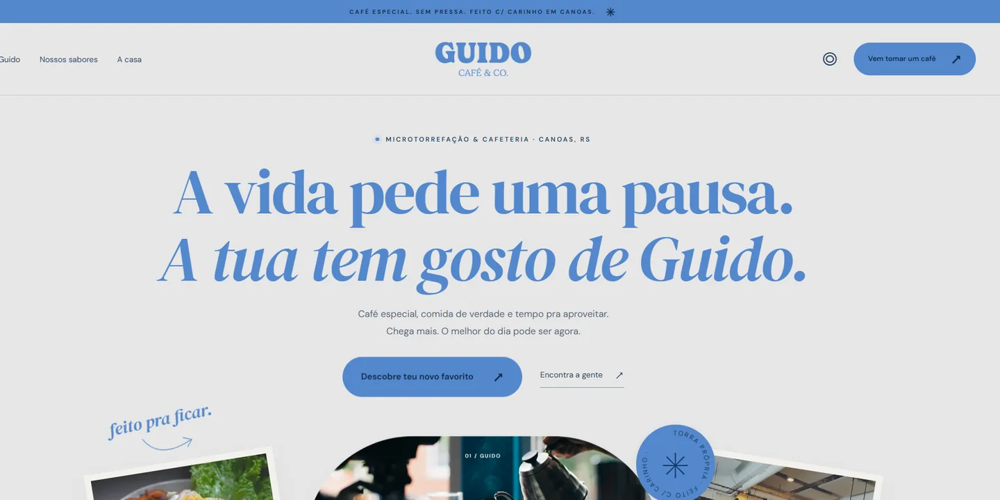
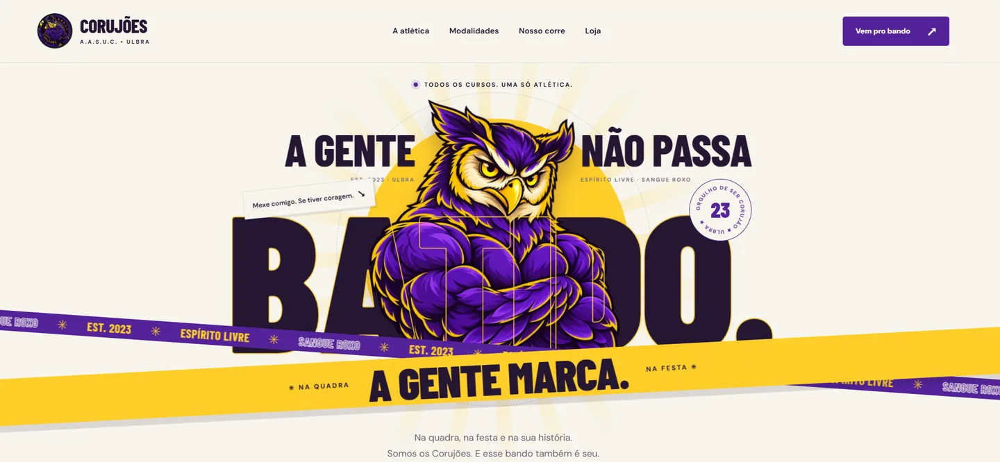
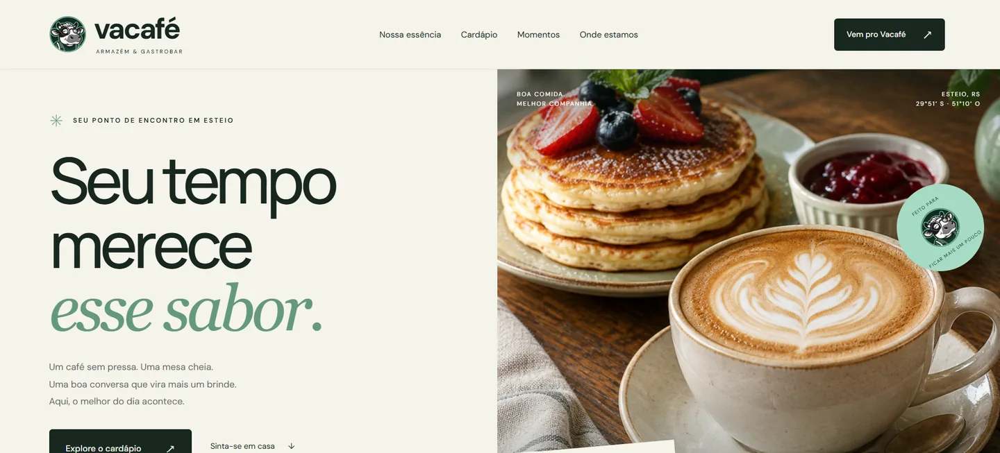
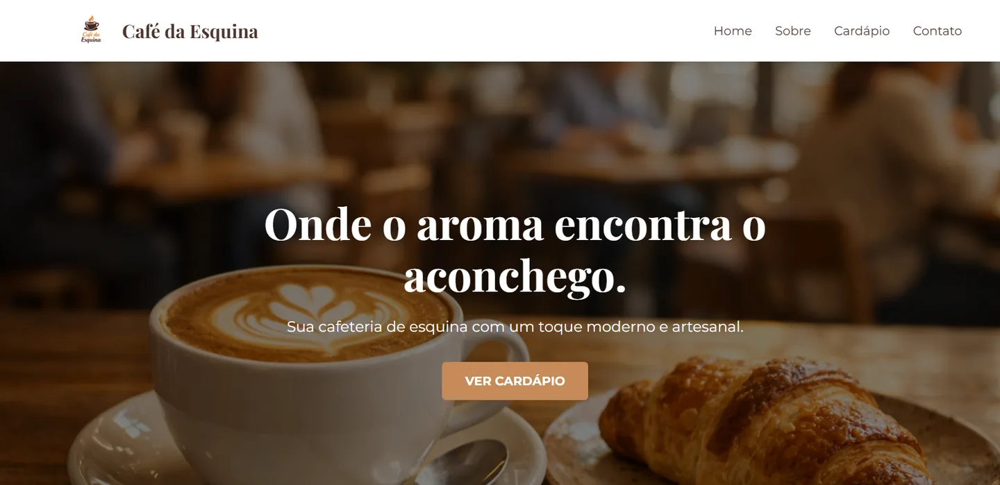

<div align="center">

# Arthur Scharfenberger — Portfólio

**Desenvolvedor Full-Stack · AI Builder · Estudante de TI**

Portfólio pessoal com tema inspirado no anime *86 –Eighty Six–*: interface de HUD militar, tema claro e escuro, rolagem suave e animações guiadas pelo scroll.

[](https://iamarthurzin.site/)
[](https://www.linkedin.com/in/ArthurScharfenberger)
[](https://www.instagram.com/iamarthurzin/)

</div>

---

## ✦ Trabalhos em destaque

Sites que desenvolvi para negócios e organizações reais, todos no ar:

<table>
<tr>
<td width="50%" valign="top">
<a href="https://guido-cafe.vercel.app"></a>
<br/><b><a href="https://guido-cafe.vercel.app">Guido Café & Co.</a></b><br/>
<sub>Cafeteria · Canoas, RS</sub><br/>
Microtorrefação e cafeteria com identidade editorial em azul e tipografia serifada.
</td>
<td width="50%" valign="top">
<a href="https://corujoes-site.vercel.app"></a>
<br/><b><a href="https://corujoes-site.vercel.app">Corujões</a></b><br/>
<sub>Atlética · ULBRA</sub><br/>
Site da atlética A.A.S.U.C. com mascote em destaque, faixas em movimento, modalidades e loja.
</td>
</tr>
<tr>
<td width="50%" valign="top">
<a href="https://va-cafe.vercel.app"></a>
<br/><b><a href="https://va-cafe.vercel.app">Vacafé</a></b><br/>
<sub>Armazém & gastrobar · Esteio, RS</sub><br/>
Hero editorial em verde-sálvia, cardápio, momentos e localização da casa.
</td>
<td width="50%" valign="top">
<a href="https://site-cafe-da-esquina.vercel.app"></a>
<br/><b><a href="https://site-cafe-da-esquina.vercel.app">Café da Esquina</a></b><br/>
<sub>Cafeteria</sub><br/>
Cafeteria de esquina com toque artesanal: ambiente, sobre, cardápio e contato.
</td>
</tr>
</table>

---

## 🧭 O que tem no site

| Seção | Conteúdo |
|---|---|
| **Hero** | Apresentação com texto que se revela letra por letra, cargo embaralhado em loop e cartão de identificação com HUD |
| **01 · Destaques** | Os quatro sites de clientes, com print e link para a versão ao vivo |
| **02 · Ficha** | Sobre mim, dossiê com contatos e contadores animados |
| **03 · Protocolo** | Como eu trabalho, em cartões empilhados que se sobrepõem na rolagem |
| **Arsenal** | Ferramentas e linguagens que uso |
| **Esquadrão** | Galeria de personagens com efeito de profundidade no mouse |
| **04 · Canal** | Contato via LinkedIn, GitHub e Instagram |

Também tem tema **Setor 86** (escuro) e **República** (claro) com transição circular, cursor de mira personalizado e uma intro de "sincronização" que aparece só na primeira visita da sessão.

---

## ⚡ Performance

As animações foram pensadas para rodar lisas mesmo com bastante efeito na tela:

- Animações só com `transform` e `opacity`, sem animar `top`, `left`, `box-shadow` ou `filter`
- Nada de `mix-blend-mode` ou `backdrop-filter` em camadas de tela inteira
- Partículas em `<canvas>` com quantidade reduzida, resolução limitada e pausa quando saem da tela ou a aba fica em segundo plano
- Faixas em movimento que medem o tamanho só no resize e param quando não estão visíveis
- Imagens em WebP com `loading="lazy"`
- Respeita `prefers-reduced-motion`: quem pede menos movimento recebe o site sem animações

---

## 🛠️ Tecnologias

- **HTML, CSS e JavaScript** puros, sem framework e sem etapa de build
- **[GSAP](https://gsap.com/) 3.12** + **ScrollTrigger**, para as animações e os efeitos ligados ao scroll
- **[Lenis](https://lenis.darkroom.engineering/)**, para a rolagem suave
- **Google Fonts**: Chakra Petch, IBM Plex Sans, IBM Plex Mono e Noto Sans JP
- Deploy na **[Vercel](https://vercel.com/)**

---

## 📁 Estrutura

```
Portifolio/
├── index.html          # o site inteiro: HTML, CSS e JS num arquivo só
├── img/
│   ├── destaques/      # prints dos sites em destaque
│   ├── anime/          # artes do tema (hero, cenas, personagens)
│   └── arthur.webp     # foto do cartão de identificação
└── dncar/              # arquivos de logo
```

---

<div align="center">

<sub>Arte de <i>86 –Eighty Six–</i> © Asato Asato/KADOKAWA/Project-86 · uso sem fins comerciais, apenas como tema do portfólio.</sub>

<br/><br/>

Feito por **Arthur Scharfenberger** · Sapucaia do Sul, RS

</div>
